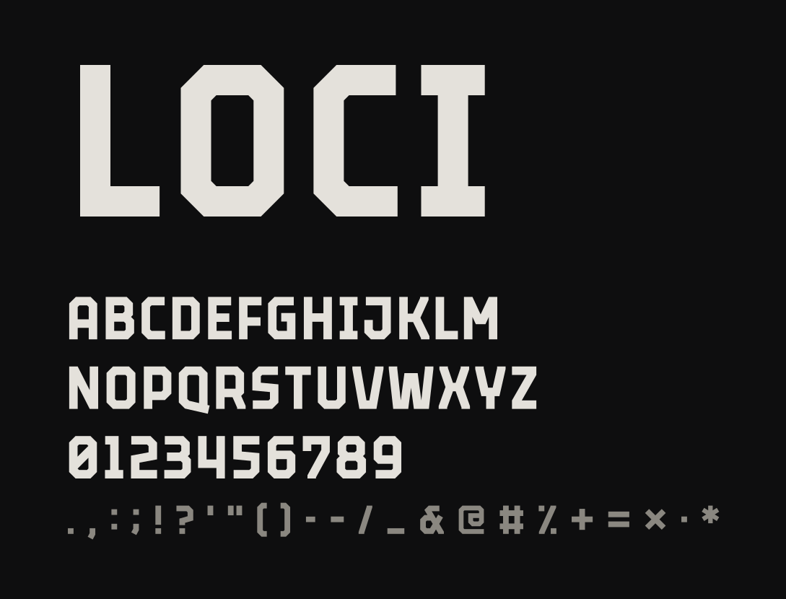

# Loci

**[View the type specimen →](https://yang-yibinn.github.io/loci-font/)**



Loci is a single-weight display face of capitals, figures and essential
punctuation. It was made for the Loci desktop app, for the wordmark, headings,
mode names and numbers: anywhere the interface should feel carved.

Each glyph is drawn as centreline polylines stroked at a fixed width, with butt
caps, miter joins and 45° chamfers. There are no curves.

Loci is derived from [Tektur](https://github.com/hyvyys/Tektur) by Adam
Jagosz and is free to use under the SIL Open Font License.

## Download

Get the latest version from the [Releases](../../releases/latest) page, or
download the files directly:

| File | Use |
| --- | --- |
| [`fonts/otf/Loci-Regular.otf`](fonts/otf/Loci-Regular.otf) | Desktop: design apps, word processors |
| [`fonts/webfonts/Loci-Regular.woff2`](fonts/webfonts/Loci-Regular.woff2) | Websites and web apps |

## Character set

```
A B C D E F G H I J K L M N O P Q R S T U V W X Y Z
0 1 2 3 4 5 6 7 8 9
. , : ; ! ? ' " ( ) - – / _ & @ # % + = × · *
```

Lowercase a–z type as the capitals. Space and no-break space are included.
Accented letters and other scripts are not.

## Installing

**Desktop:** open `Loci-Regular.otf` and click **Install** (Windows) or
**Install Font** (macOS).

**Web:** host the WOFF2 file alongside your site and add:

```css
@font-face {
  font-family: "Loci";
  src: url("Loci-Regular.woff2") format("woff2");
  font-weight: 400;
  font-style: normal;
  font-display: swap;
}

h1 {
  font-family: "Loci", sans-serif;
}
```

## Repository layout

| Path | Contents |
| --- | --- |
| `fonts/` | The compiled fonts (OTF with GPOS kerning, and WOFF2) |
| `sources/glyphs.json` | The source: centreline polylines, kept Tektur outlines, spacing and kerning |
| `docs/` | The type specimen (`index.html`) and the README image |
| `FONTLOG.txt` | Design notes and changelog |
| `OFL.txt` | The licence |

## License

Loci is licensed under the [SIL Open Font License 1.1](OFL.txt). You can use
it for free in personal and commercial work, and bundle, embed or modify it.
The one thing you can't do is sell the font files on their own. Modified
versions must also be released under the OFL.

Copyright 2023 The Tektur Project Authors. Copyright 2026 Yibin Yang.

## Credits

- **Yibin Yang**: Loci's alphabet, outlines, punctuation, spacing and kerning
- **Adam Jagosz**: designer of [Tektur](https://github.com/hyvyys/Tektur), the
  typeface Loci is derived from
